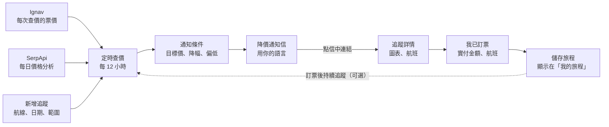
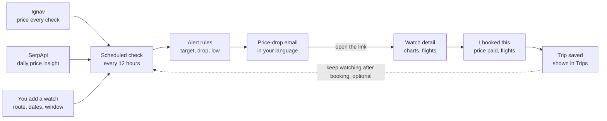

# Flight Watch — App 設計摘要 / Design Summary

中文版在前，English version follows below. 設計稿畫面在 [`docs/mockup/`](mockup/)。

---

# 繁體中文

Flight Watch 幫你盯著指定航線和日期的機票價格，降價時寄信通知你，用圖表比較鄰近日期看提早或延後出發會不會比較便宜，並記錄你訂好的旅程。介面有英文和繁體中文（預設中文，可切換）。先做一般票價，哩程兌換票之後再加。

## 運作方式

每次查價由 Ignav 提供票價；SerpApi 每天補上 Google 對價格高低的判斷。訂票後可以繼續追蹤，買完票如果降價也會通知你。

## 畫面

共 7 個畫面（每個都有英文和中文版，頂部有「中文 | EN」切換），加上一封通知信。

| 畫面 | 功能 | 開發階段 |
| --- | --- | --- |
| 我的追蹤（主畫面） | 摘要數字、最新降價通知、每個追蹤一張卡片（近 30 天走勢和目前票價）。可刪除，先確認再提供復原。 | 2 |
| 新增追蹤 | 航線、日期、來回或單程、日期範圍（精確 / 前後 3 天 / 前後 7 天）、航空公司或聯盟、艙等、轉機、幣別、查價頻率、目標價。會估算每月查價次數。 | 2 |
| 追蹤詳情 | 目前最低價和 Google 價格判斷；鄰近日期長條圖；價格走勢圖（預設隱藏）；通知條件；最便宜航班和訂票按鈕；「我已訂票」。 | 3–5 |
| 降價通知信 | 新價格、舊價格、為什麼收到通知、三個鄰近日期、查看圖表和訂票按鈕。 | 5 |
| 我的旅程 | 即將出發（倒數）、過去（依年份）、統計（哩程、國家、航空公司、花費和省下的錢）。 | 6 |
| 旅程詳情 | 航班、訂票資訊、訂位代號（點了才顯示）、備註，以及訂票後的票價追蹤（可選）。 | 6 |
| 我已訂票 | 把追蹤轉成旅程：實付金額、航班、訂票管道，以及是否繼續追蹤更低的價格。 | 6 |

## 主要功能規則

| 功能 | 運作方式 |
| --- | --- |
| 日期範圍 | 每個追蹤可選精確日期、前後 3 天或前後 7 天。鄰近日期維持同樣旅行天數（整趟行程一起提早或延後）。 |
| 查價頻率 | 你的日期每 6、12（預設）或 24 小時查一次，鄰近日期每天一次。離出發超過 90 天時會查得比較少。 |
| 航空公司 | 不限、航空聯盟（星空聯盟、寰宇一家、天合聯盟）或指定航空公司代碼。 |
| 幣別 | 每個追蹤自選：USD、TWD、JPY、EUR、GBP、HKD、SGD、CAD、AUD、KRW。 |
| 通知 | 低於目標價、比上次通知再降 US$50 或 5%、出現最低價、或 Google 判定偏低時寄信。每個追蹤每 12 小時最多一封。 |
| 訂票後 | 「我已訂票」把追蹤轉成旅程，可繼續追蹤；比實付低 US$50 以上就通知。 |
| 刪除 | 先確認，再出現復原按鈕。追蹤會馬上隱藏，7 天後才真正刪除。 |
| 價格走勢圖 | 追蹤詳情頁預設隱藏，點一下顯示。 |
| 語言 | 所有畫面和通知信都有英文和繁體中文。網站依瀏覽器語言自動選擇，手動切換後會記住。 |

## 票價資料

票價來自兩個外部服務。開發期間使用內建的「假資料」模式（`PRICE_PROVIDER=mock`），不需要金鑰也不花錢。

| | Ignav | SerpApi（Google 航班） |
| --- | --- | --- |
| 用途 | 每一次定時查價 | 每個追蹤每天一次，只查你的日期 |
| 提供 | 最低票價、航空公司、航班、訂票連結 | Google 價格判斷（偏低 / 一般 / 偏高）、一般價格範圍、歷史價格 |
| 費用 | 前 1,000 次免費，之後每 1,000 次 US$2 | 免費方案每月 250 次 |

**比價規則**：降價只用 Ignav 和 Ignav、同幣別比較。兩個來源混在一起比，會產生「假降價」。

## 技術架構

| 部分 | 工具 |
| --- | --- |
| 網頁 App | Next.js 16 + TypeScript、Tailwind CSS v4、npm |
| 多語言 | next-intl（`/en/...`、`/zh-TW/...`） |
| 資料庫和登入 | Supabase（Postgres、Email 魔法連結登入） |
| 主機和定時查價 | Netlify |
| 寄信 | Resend |
| 視覺風格 | 深藍色頂部、琥珀色主按鈕、IBM Plex Sans / Mono，中文用 Noto Sans TC |

## 開發階段

| 階段 | 內容 | 狀態 |
| --- | --- | --- |
| 1. 基礎架構 | App 外框、雙語、登入、資料庫、空白主畫面 | 完成（分支待合併） |
| 2. 追蹤 | 新增追蹤表單、主畫面卡片、詳情頁外框、刪除和復原、暫停；機場清單（自動完成） | 下一個 |
| 3. 真實票價 | Ignav、定時查價、鄰近日期圖表、最便宜航班、訂票按鈕 | |
| 4. 價格分析 | SerpApi 價格判斷和歷史、價格走勢圖、走勢小圖 | |
| 5. 通知 | 通知條件、雙語降價通知信 | |
| 6. 旅行紀錄 | 我的旅程、旅程詳情、「我已訂票」、統計、訂票後追蹤 | |
| 7. 優化 | 載入和錯誤畫面、手機版面、清理排程 | |
| 之後 | 哩程兌換票搜尋、LINE 或 Telegram 通知、從 Email 匯入訂票 | |

## 去哪裡找

- **完整規格書**：專案根目錄的 [`SPEC.md`](../SPEC.md)。
- **Claude Code 共用規則**：[`CLAUDE.md`](../CLAUDE.md)。
- **設計稿**：[`docs/mockup/`](mockup/)，每個畫面一個檔案（`*Zh` 是中文版）。
- **設定指南**：[`docs/setup-guide.zh-TW.md`](setup-guide.zh-TW.md)。

---

# English

Flight Watch watches flight prices for a route and dates you choose, emails you when the price drops, charts nearby dates so you can see if shifting the trip saves money, and keeps a log of trips you booked. It runs in Traditional Chinese (default) and English, with a toggle. Cash fares come first; award (miles) search comes later.

## How it works

Ignav supplies the price on every check; SerpApi adds Google's daily view of whether the price is low. Booked trips can keep being watched, so you hear about a drop even after you buy.

## Screens

Seven screens, each in Chinese and English with a 中文 | EN toggle in the header, plus one email.

| Screen | What it does | Phase |
| --- | --- | --- |
| Watch list (dashboard) | Summary tiles, latest price-drop banner, one card per watch with a 30-day sparkline and current price. Delete with confirm and Undo. | 2 |
| New watch | Route, dates, trip type, date window (exact / ±3 / ±7), airlines or alliance, cabin, stops, currency, check frequency, target price. Shows an estimate of checks per month. | 2 |
| Watch detail | Current lowest price and Google's price level; nearby-dates bar chart; price-over-time chart (hidden by default); alert rules; cheapest flights with Book buttons; "I booked this". | 3–5 |
| Price-drop email | Price, old price, why the alert fired, three nearest dates, View chart and Book buttons. | 5 |
| Trips | Upcoming (with countdown), Past (by year), Stats (miles, countries, airlines, money spent and saved). | 6 |
| Trip detail | Flights, booking info, confirmation code (hidden until clicked), notes, and an optional price watch after booking. | 6 |
| I booked this | Turns a watch into a trip: price paid, flights, booking site, and whether to keep watching for a lower price. | 6 |

## Key behaviors

| Feature | How it works |
| --- | --- |
| Date window | Each watch checks the exact dates, ±3 days or ±7 days. Nearby dates keep the same trip length (the whole trip shifts). |
| Check frequency | Your dates every 6, 12 (default) or 24 hours. Nearby dates once a day. Slower when departure is more than 90 days away. |
| Airlines | Any airline, an alliance (Star Alliance, oneworld, SkyTeam) or specific airline codes. |
| Currency | Chosen per watch: USD, TWD, JPY, EUR, GBP, HKD, SGD, CAD, AUD or KRW. |
| Alerts | Email when the price is below your target, drops $50 or 5% since the last alert, hits the lowest seen, or Google rates it low. At most one email per watch every 12 hours. |
| After booking | "I booked this" turns a watch into a trip and can keep watching, emailing you if the price drops $50 or more below what you paid. |
| Delete | Confirm first, then an Undo bar. The watch is hidden right away and fully removed after 7 days. |
| Price history chart | Hidden by default on the watch page; one click to show. |
| Languages | Every screen and email in Chinese and English. The site picks from the browser language and remembers a manual switch. |

## Price data

Two outside services supply prices; during development a built-in fake provider (`PRICE_PROVIDER=mock`) is used, so no keys or costs are needed.

| | Ignav | SerpApi (Google Flights) |
| --- | --- | --- |
| Used for | Every scheduled price check | Once a day per watch, your dates only |
| Gives us | Lowest fare, airline, flights, booking links | Google's price level (low / typical / high), typical price range, price history |
| Cost | $2 per 1,000 searches after 1,000 free | Free tier: 250 searches a month |

**The comparison rule:** a price drop is only measured Ignav against Ignav, in the same currency. Mixing the two sources would create fake price drops.

## Tech stack

| Part | Tool |
| --- | --- |
| Web app | Next.js 16 + TypeScript, Tailwind CSS v4, npm |
| Languages | next-intl (`/en/...`, `/zh-TW/...`) |
| Database and sign-in | Supabase (Postgres, magic-link email login) |
| Hosting and scheduled checks | Netlify |
| Email | Resend |
| Look | Navy header, amber main button, IBM Plex Sans and Mono, Noto Sans TC for Chinese |

## Build phases

| Phase | What gets built | Status |
| --- | --- | --- |
| 1. Scaffold | App shell, both languages, sign-in, database, empty dashboard | Done (branch awaiting merge) |
| 2. Watches | New-watch form, dashboard cards, detail page shell, delete and Undo, pause; airports list for autocomplete | Next |
| 3. Real prices | Ignav, scheduled checks, nearby-dates chart, cheapest flights, Book button | |
| 4. Insights | SerpApi price level and history, price-over-time chart, sparklines | |
| 5. Alerts | Alert rules, price-drop emails in both languages | |
| 6. Travel log | Trips, trip detail, "I booked this", stats, price watch after booking | |
| 7. Polish | Loading and error states, phone layout, cleanup jobs | |
| Later | Award (miles) search, LINE or Telegram alerts, email import of bookings | |

## Where to find things

- **Full spec:** [`SPEC.md`](../SPEC.md).
- **Shared Claude Code rules:** [`CLAUDE.md`](../CLAUDE.md).
- **Mockup:** [`docs/mockup/`](mockup/), one file per screen (`*Zh` = Chinese).
- **Setup guide:** [`docs/setup-guide.zh-TW.md`](setup-guide.zh-TW.md).
